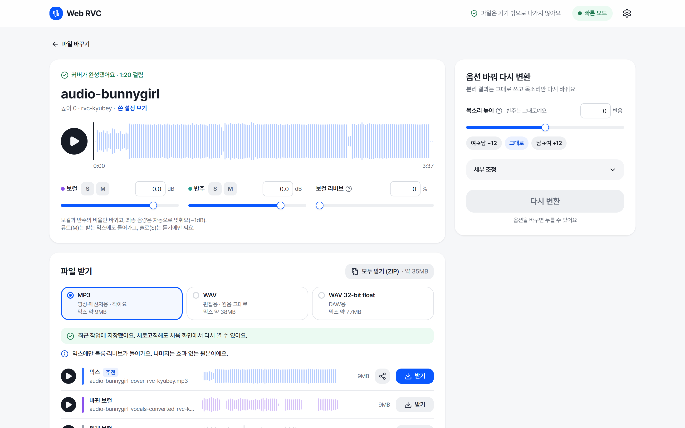
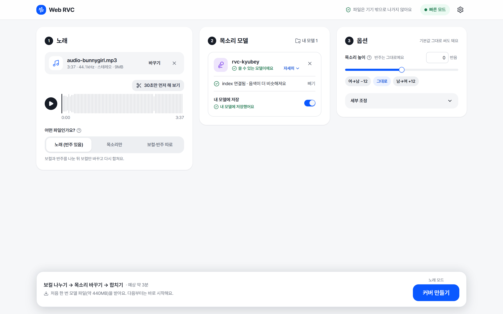
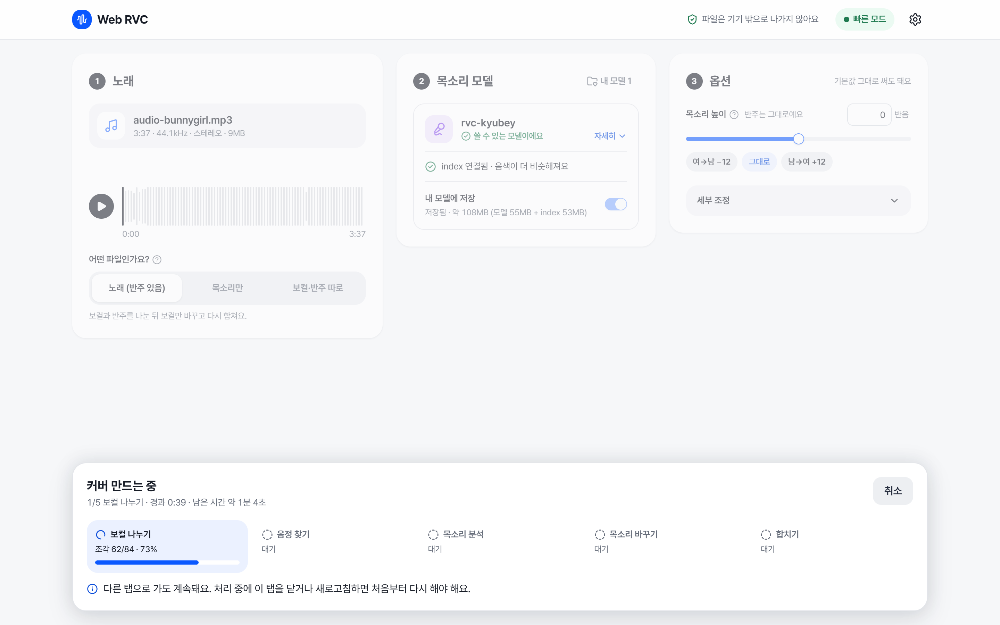

# Web RVC

[English](README.md)

브라우저에서 내 GPU로 AI 커버를 만듭니다. 노래와 RVC 목소리 모델을 넣으면 보컬을 분리하고, RVC로 바꾼 뒤, 반주와 다시 합칩니다. 파일은 기기 밖으로 나가지 않습니다.



## 기능

- **노래에서 커버까지 한 번에.** UVR 보컬 분리, RMVPE 피치 추출, RVC 변환, 믹싱이 한 흐름으로 이어집니다.
- **가진 모델 그대로.** `.pth`(`.index`는 선택), weights.gg 형식 `.zip`을 그대로 넣습니다. RVC WebUI와 Applio에서 내보낸 ONNX도 됩니다.
- **세 가지 입력.** 반주가 있는 노래, 목소리만 있는 녹음, 따로 분리해 둔 보컬과 반주.
- **빠른 재변환.** 키만 바꾸면 분리 결과는 재사용하고 변환만 다시 합니다.
- **믹스와 내보내기.** 게인, 솔로/뮤트, 리버브를 조절합니다. MP3, WAV, 32-bit float WAV로 받거나 스템 전체를 ZIP으로 받습니다.
- **기기에 보관.** 저장한 모델과 최근 작업 3개는 새로고침해도 남습니다.

| 파일 넣기 | 처리 중 |
|---|---|
|  |  |

## 요구 사항

- WebGPU를 지원하는 Chrome 또는 Edge. 그래픽 메모리 약 6GB 이상을 권장합니다.
- WebGPU가 없으면 WebAssembly로 동작하며, 약 7배 느립니다.
- 처음 한 번 공용 모델 약 440MB를 받아 캐시합니다.

RTX 3090 기준 3분 37초 곡이 약 1분 30초 걸립니다.

## 개발

```bash
npm install
npm run dev
```

개발 서버는 공용 모델을 `weights/dist/`에서 제공합니다. 게시된 모델을 쓰려면 `.env.local`을 만드세요.

```
VITE_MODEL_BASE_URL=https://huggingface.co/trolley/rvc-webgpu/resolve/0afdab883289224320b56cc8091c66f669c31c56/
```

`npm test`, `npm run lint`, `npm run build`로 검사하고 빌드합니다. GitHub Pages 프로젝트 사이트로 빌드할 때는 `BASE_PATH=/<repo>/`를 지정하세요.

## 모델

공용 모델(ContentVec, RMVPE, UVR, RVC 합성기 그래프)은 [huggingface.co/trolley/rvc-webgpu](https://huggingface.co/trolley/rvc-webgpu)에 있습니다. [tools/](tools/README.md)로 원본 체크포인트에서 다시 만들 수 있습니다.

## 크레딧

[RVC](https://github.com/RVC-Project/Retrieval-based-Voice-Conversion-WebUI), [Ultimate Vocal Remover](https://github.com/Anjok07/ultimatevocalremovergui), RMVPE, ContentVec, [ONNX Runtime Web](https://onnxruntime.ai/)을 바탕으로 만들었습니다. 모델별 출처는 [tools/LICENSES.md](tools/LICENSES.md)에 있습니다. MP3 내보내기에는 LAME(LGPL)을 씁니다.

권리가 있는 목소리와 노래만 변환하세요.

## 라이선스

[MIT](LICENSE)
