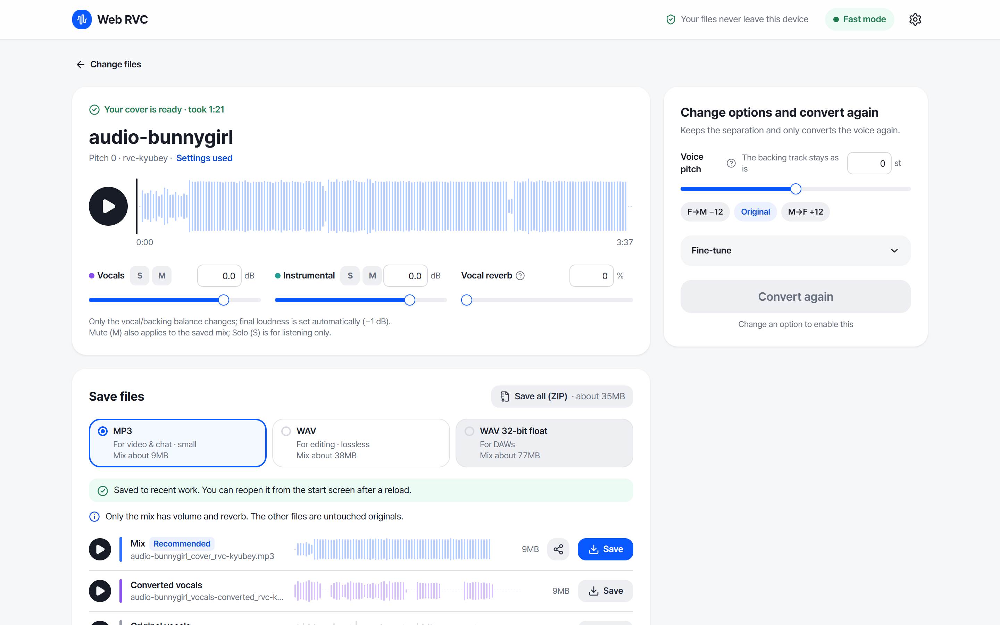
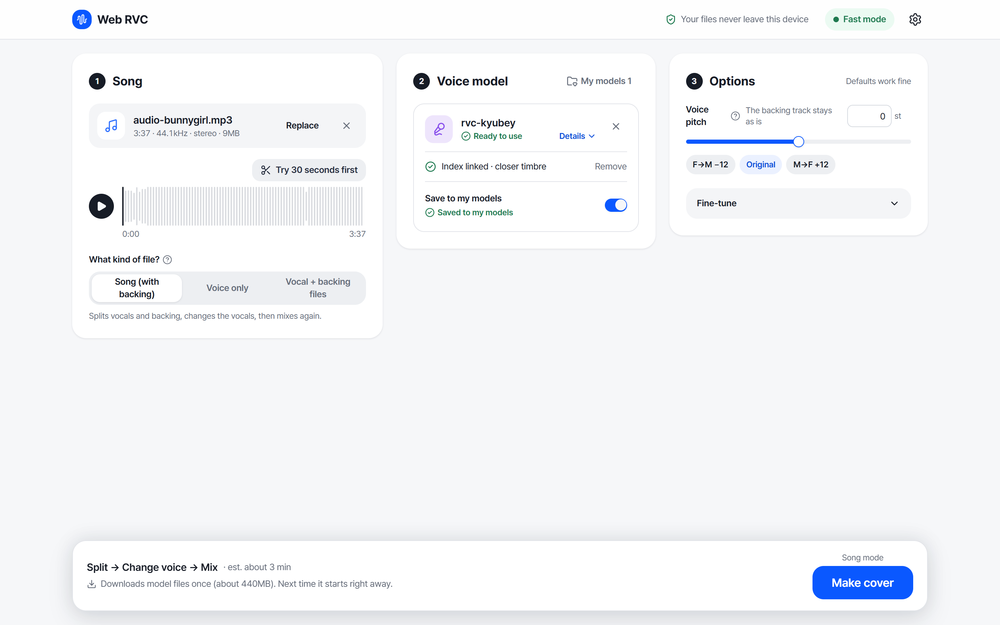
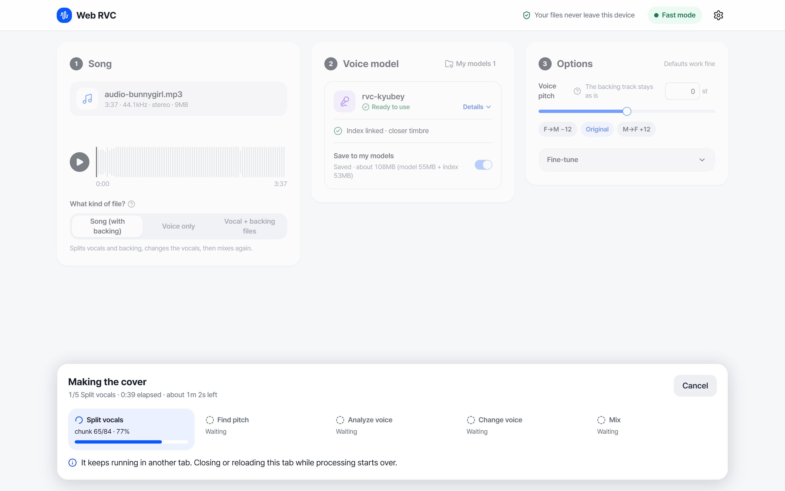

#  Web RVC

**[rvc.ouor.me](https://rvc.ouor.me)** · [한국어](README.ko.md)

Make AI covers in the browser, on your own GPU. Drop in a song and an RVC voice model: Web RVC separates the vocals, converts them with RVC, and mixes them back with the instrumental. Your files never leave your device.



## Features

- **Song → cover in one click.** UVR vocal separation, RMVPE pitch, RVC conversion and mixdown in one pipeline.
- **Use models as you have them.** `.pth`, with or without `.index`, or a weights.gg-style `.zip`. ONNX exports from RVC WebUI and Applio also work.
- **Three input types.** A full song, a voice-only recording, or vocals and instrumental as separate files.
- **Fast re-runs.** Change the pitch and only the conversion runs again. Separation is reused.
- **Mix and export.** Gain, solo/mute and reverb. Export as MP3, WAV or 32-bit float WAV, or download all stems as a ZIP.
- **Kept on this device.** Saved models and your last three jobs survive a reload.

| Add files | Processing |
|---|---|
|  |  |

## Requirements

- Chrome or Edge with WebGPU. A GPU with about 6 GB of memory is recommended.
- Without WebGPU it falls back to WebAssembly, which is about 7× slower.
- The first run downloads about 440 MB of shared models, then caches them.

A 3:37 song takes about 1.5 minutes on an RTX 3090.

## Development

```bash
npm install
npm run dev
```

The dev server serves the shared models from `weights/dist/`. To use the published models instead, create `.env.local`:

```
VITE_MODEL_BASE_URL=https://huggingface.co/trolley/rvc-webgpu/resolve/0afdab883289224320b56cc8091c66f669c31c56/
```

`npm test`, `npm run lint` and `npm run build` check and build the app. Set `BASE_PATH=/<repo>/` when building for a GitHub Pages project site.

Using the engine on its own: [docs/engine.md](docs/engine.md).

## Models

The shared models (ContentVec, RMVPE, UVR, RVC synthesizer graphs) are hosted at [huggingface.co/trolley/rvc-webgpu](https://huggingface.co/trolley/rvc-webgpu). [tools/](tools/README.md) rebuilds them from the original checkpoints.

## Credits

Built on [RVC](https://github.com/RVC-Project/Retrieval-based-Voice-Conversion-WebUI), [Ultimate Vocal Remover](https://github.com/Anjok07/ultimatevocalremovergui), RMVPE, ContentVec and [ONNX Runtime Web](https://onnxruntime.ai/). The origin of each model is listed in [tools/LICENSES.md](tools/LICENSES.md). MP3 export uses LAME (LGPL).

Only convert voices and songs you have the rights to use.

## License

[MIT](LICENSE)
